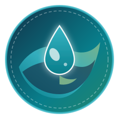

# 🌊 AQUAMARIS — Plataforma de Ingeniería Hídrica & Demanda de Agua



Plataforma profesional, técnica y auditable de **Ingeniería Sanitaria e Hidráulica**, desarrollada en **Python** y **Streamlit** para el cálculo riguroso de la demanda de agua potable (doméstica e industrial), balances hídricos y dimensionamiento de obras civiles de acueducto.

Implementa de forma estricta el marco normativo colombiano **RAS (Resolución 0330 de 2017 del Ministerio de Vivienda, Ciudad y Territorio)** y ofrece un **Modo Exploratorio / Libre** para proyectos de investigación y análisis de sensibilidad técnica.

- 🌐 **Acceso Público en la Nube:** [https://calculadorademanda-n4xhr79pr8bmbfrykfey8k.streamlit.app/](https://calculadorademanda-n4xhr79pr8bmbfrykfey8k.streamlit.app/)
- 💻 **Servidor Local:** [http://localhost:8501](http://localhost:8501)

---

## 🎨 Identidad Visual y Paleta "Aqua Natura"

Inspirada en los ecosistemas hídricos y oceánicos, **AQUAMARIS** incorpora una ambientación marina interactiva con micro-animaciones fluidas de oleaje, gotas en suspensión y efectos de inmersión en tarjetas de datos:

| Tonalidad | Código HEX | Rol en la Interfaz |
| :--- | :---: | :--- |
| **Azul profundo** | `#123047` | Encabezados, barras de navegación y tarjetas de fondo oscuro. |
| **Azul río** | `#087E8B` | Botones de acción, pestañas seleccionadas y controles activos. |
| **Turquesa agua** | `#38B6C5` | Ondas marinas, gotas en suspensión, resaltados y micro-animaciones CSS. |
| **Verde bosque** | `#25866C` | Indicadores de cumplimiento normativo RAS y alertas de verificación exitosa. |
| **Verde natural** | `#83B88C` | Etiquetas ecológicas, detalles técnicos secundarios y acentos visuales. |
| **Blanco niebla** | `#F4F9F8` | Fondo general de la aplicación y crestas de ondas. |

---

## 📋 Tabla de Contenidos
- [Características Principales](#-características-principales)
- [Marco Normativo RAS 0330 / 2017 vs. Modo Exploratorio](#-marco-normativo-ras-0330--2017-vs-modo-exploratorio)
- [Fundamentación Matemática y Ecuaciones Hidráulicas](#-fundamentación-matemática-y-ecuaciones-hidráulicas)
- [Catálogo de 17 Benchmarks Industriales Formales](#-catálogo-de-17-benchmarks-industriales-formales)
- [Diferenciación Rigurosa entre Demanda Media y Caudales Máximos](#-diferenciación-rigurosa-entre-demanda-media-y-caudales-máximos)
- [Reconstrucción Profesional del Libro Excel (5 Hojas)](#-reconstrucción-profesional-del-libro-excel-5-hojas)
- [Informe Técnico en PDF](#-informe-técnico-en-pdf)
- [Estructura del Proyecto](#-estructura-del-proyecto)
- [Instalación y Ejecución Local](#-instalación-y-ejecución-local)
- [Pruebas Unitarias Automatizadas (pytest)](#-pruebas-unitarias-automatizadas-pytest)

---

## 🌟 Características Principales

1. **Ambientación Marina y Marca Propia:**
   - Logotipo vectorial oficial SVG integrado, simulando un escudo oceánico con oleaje dinámico y gota cristalina.
   - Animaciones fluidas en CSS (`@keyframes waveMove`, `@keyframes waveBack`, `@keyframes floatDroplet`) con estética marina inmersiva sobre la paleta **Aqua Natura**.
2. **Organización en 5 Módulos Especializados:**
   - 🏠 **1. Demanda Doméstica:** Selección por pisos térmicos / altitud o modo libre, cálculo de dotación bruta y pérdidas técnicas en red.
   - 🏭 **2. Demanda Industrial:** Catálogo ampliado de 17 sectores industriales con consumos específicos respaldados en literatura técnica (Banco Mundial/IFC, PNUMA, FAO, CEPIS/OPS, IPPC BREF, Metcalf & Eddy, ACI), turnos operativos ($Q_{op}$), asistente de incorporación rápida, plantillas de sector y editor unificado `st.data_editor`.
   - 📊 **3. Resultados y Auditoría:** Gráfica comparativa de demandas, balance hídrico global, cuadro de mando de caudales y matriz de auditoría casilla por casilla.
   - 📐 **4. Memoria de Fórmulas y Teoría:** Exposición analítica completa de las ecuaciones de continuidad (factor 86.40), dotación bruta, caudales en turno $Q_{op}$, coeficientes $k_1$ y $k_2$, asignación a obras civiles y sustitución numérica en vivo con los datos del proyecto.
   - 📥 **5. Exportación de Informes:** Generación de memoria técnica en Excel (`.xlsx`) de 5 hojas y reporte ejecutivo en PDF (`.pdf`). Se eliminaron completamente formatos planos obsoletos (TXT y CSV).
3. **Cumplimiento Normativo RAS (Resolución 0330 de 2017):**
   - Validación automática de topes de dotación neta (Art. 43) y pérdidas técnicas máximas del 25% (Art. 44).
4. **Excel con Fórmulas Vivas y Verificación:**
   - 5 hojas estructuradas con fórmulas de celdas (`openpyxl`), tipografía Calibri corporativa, gráficos incrustados y verificación `Python vs Excel`.

---

## 🏛️ Marco Normativo RAS 0330 / 2017 vs. Modo Exploratorio

| Criterio / Parámetro | Modo Normativo RAS (Res. 0330/2017) | Modo Exploratorio / Libre |
| :--- | :--- | :--- |
| **Dotación Neta Máxima (Art. 43)** | - Clima Frío ($> 2.000\text{ msnm}$): **$120\text{ L/hab}\cdot\text{día}$**<br/>- Clima Templado ($1.000 - 2.000\text{ msnm}$): **$130\text{ L/hab}\cdot\text{día}$**<br/>- Clima Cálido ($< 1.000\text{ msnm}$): **$140\text{ L/hab}\cdot\text{día}$** | Admite dotaciones ampliadas ($25 - 500\text{ L/hab}\cdot\text{día}$) con advertencias técnicas para investigación o normativas internacionales. |
| **Pérdidas Técnicas en Red (Art. 44)** | **Máximo 25.0%** ($P \le 25\%$) conforme a metas de eficiencia física de red. | Permite modelar redes en estado crítico de fugas hasta el $55.0\%$. |
| **Factores de Pico ($k_1, k_2$)** | Art. 47 y 48: Sugeridos automáticamente por tamaño poblacional ($k_1 = 1.20 - 1.30$, $k_2 = 1.40 - 1.60$). | Ajustables manualmente por el proyectista con comprobación de límites físicos ($k \ge 1.00$). |
| **Régimen Industrial** | Distingue industrias con almacenamiento propio (régimen continuo amortiguado) de industrias sin tanque. | Permite seleccionar libremente si $k_1$ y $k_2$ afectan al sector industrial. |

---

## 📐 Fundamentación Matemática y Ecuaciones Hidráulicas

### 1. Factor de Conversión de Caudal Continuo
Considerando $86\,400$ segundos en un día ($24 \times 60 \times 60$) y $1\text{ m}^3 = 1\,000\text{ L}$:

$$\text{Factor} = \frac{86\,400 \text{ s/día}}{1\,000 \text{ L/m}^3} = 86.40$$

$$V \text{ [m}^3/\text{día]} = Q \text{ [L/s]} \times 86.40 \quad \Longleftrightarrow \quad Q \text{ [L/s]} = \frac{V \text{ [m}^3/\text{día]}}{86.40}$$

### 2. Demanda Media Diaria Doméstica ($Q_{md, dom}$)
$$D_{bruta} = \frac{D_{neta}}{1 - \frac{\%P}{100}} \quad [L/\text{hab}\cdot\text{día}]$$

$$V_{dom} = \frac{P \times D_{bruta}}{1\,000} \quad [m^3/\text{día}]$$

$$Q_{md, dom} = \frac{P \times D_{bruta}}{86\,400} = \frac{V_{dom}}{86.40} \quad [L/s]$$

### 3. Demanda Industrial y Caudal en Turno ($Q_{ind}$ y $Q_{op}$)
- **Volumen Diario Consolidado:**
  $$V_{ind} = \sum_{i=1}^{n} (U_i \times c_{e,i}) \quad [m^3/\text{día}]$$
- **Caudal Medio Continuo 24h (para balances hídricos):**
  $$Q_{md, ind} = \frac{V_{ind}}{86.40} \quad [L/s]$$
- **Caudal en Turno Operativo (para dimensionamiento de acometida fabril):**
  $$Q_{op, ind} = \frac{V_{ind} \times 1\,000}{H_{op} \times 3\,600} \quad [L/s]$$

---

## 🏭 Catálogo de 17 Benchmarks Industriales Formales

El sistema cuenta con un catálogo predefinido con fuentes de literatura técnica internacional:

| Sector Productivo | Consumo Específico Típico | Turno Típico | Fuente Documentada |
| :--- | :---: | :---: | :--- |
| **Bebidas y Refrescos** | $2.50\text{ L/L}$ bebida | $16\text{ h/d}$ | PNUMA / ONUDI - Guías de Producción Limpia; IPPC BREF. |
| **Cervecería Industrial** | $4.50\text{ L/L}$ cerveza | $24\text{ h/d}$ | Metcalf & Eddy; European Commission IPPC BREF FDM (2019). |
| **Planta Láctea / Pasteurizadora** | $2.00\text{ L/L}$ leche | $16\text{ h/d}$ | Banco Mundial / IFC - Guidelines for Dairy Processing. |
| **Matadero Bovino** | $1\,200\text{ L/res}$ faenada | $8\text{ h/d}$ | FAO / CEPIS-OPS - Manual de Abastecimiento en Mataderos. |
| **Matadero Porcino** | $450\text{ L/cerdo}$ faenado | $8\text{ h/d}$ | FAO / CEPIS-OPS; Guías de Saneamiento Agroindustrial. |
| **Beneficio Avícola** | $25.0\text{ L/ave}$ faenada | $12\text{ h/d}$ | IFC / World Bank - Poultry Processing Guidelines. |
| **Textil - Tintorería** | $110.0\text{ L/kg}$ tela | $16\text{ h/d}$ | European IPPC Bureau (BREF Textiles); CONAGUA. |
| **Papel y Cartón** | $25.0\text{ m}^3\text{/ton}$ papel | $24\text{ h/d}$ | BAT Reference Document for Pulp, Paper and Board (2015). |
| **Central de Concreto** | $0.20\text{ m}^3\text{/m}^3$ conc. | $10\text{ h/d}$ | American Concrete Institute (ACI 211.1). |
| **Curtiduría de Pieles** | $35.0\text{ m}^3\text{/ton}$ piel | $12\text{ h/d}$ | UNIDO - Tanneries Environmental Benchmark. |
| **Ingenio Azucarero** | $0.85\text{ m}^3\text{/ton}$ caña | $24\text{ h/d}$ | EPA / IFC - Sugar Manufacturing Guidelines. |
| **Lavandería Industrial** | $20.0\text{ L/kg}$ ropa | $12\text{ h/d}$ | European Textile Services Association (ETSA); CONAGUA. |
| **Farmacéutica** | $180.0\text{ L/empleado}\cdot\text{d}$ | $16\text{ h/d}$ | WHO Technical Report Series; IFC Guidelines. |
| **Hotel / Resort** | $350.0\text{ L/huésped}\cdot\text{d}$ | $24\text{ h/d}$ | UNWTO / IHE Delft - Water Footprint in Tourism. |
| **Hospital / Clínica** | $600.0\text{ L/cama}\cdot\text{d}$ | $24\text{ h/d}$ | WHO Essential Environmental Health Standards; RAS. |
| **Lavadero de Vehículos** | $220.0\text{ L/vehículo}$ | $10\text{ h/d}$ | International Carwash Association (ICA). |
| **Centro Educativo / Campus** | $45.0\text{ L/estudiante}\cdot\text{d}$ | $10\text{ h/d}$ | Metcalf & Eddy; RAS Título B. |

---

## ⚡ Diferenciación Rigurosa entre Demanda Media y Caudales Máximos

| Parámetro | Símbolo | Ecuación | Obras Civiles e Hidráulicas Asignadas |
| :--- | :---: | :---: | :--- |
| **Demanda Media Diaria** | $Q_{md}$ | $Q_{dom} + Q_{ind}$ | Concesión de aguas, balance hídrico de la fuente, balances de masa y estimación de volúmenes anuales. |
| **Caudal Máximo Diario** | $Q_{MD}$ | $(Q_{dom} \cdot k_1) + Q_{ind}$ | Dimensionamiento de **obras de captación, desarenador, línea de aducción, Planta de Tratamiento de Agua Potable (PTAP) y volumen de tanques de almacenamiento**. |
| **Caudal Máximo Horario** | $Q_{MH}$ | $(Q_{dom} \cdot k_1 \cdot k_2) + Q_{ind}$ | Dimensionamiento de **redes de distribución de tuberías, mallas matrices y equipos de bombeo directo a red**. |

---

## 📊 Reconstrucción Profesional del Libro Excel (5 Hojas)

Generado dinámicamente mediante `openpyxl` aplicando la paleta visual **Aqua Natura**:

1. **`01_Resumen`:** Cuadro de mando ejecutivo con caudales en $L/s$ y $m^3/\text{día}$, porcentajes de participación, destinos de diseño y gráfico de barras incrustado.
2. **`02_Datos_Entrada`:** Parámetros de diseño (población, altitud, dotación neta, pérdidas, $k_1$, $k_2$).
3. **`03_Memoria_Calculo`:** Trazabilidad paso a paso con **fórmulas nativas de Excel enlazadas a celdas** (`=B7/(1-B8)`, `=E5*1000/86400`, etc.).
4. **`04_Detalle_Industrial`:** Desglose pormenorizado por industria, horas de operación, caudales de turno ($Q_{op}$), fuentes técnicas documentadas y totales con función `=SUM(...)`.
5. **`05_Verificacion`:** Auditoría de concordancia entre los cálculos de Python y las fórmulas de Excel, certificando concordancia exacta ($0.000000$, tolerancia $< 10^{-4}$).

---

## 📁 Estructura del Proyecto

```
HIDROLOGIA JEFERSON/
├── assets/
│   └── logo.svg             # Logotipo vectorial oficial AQUAMARIS en SVG
├── app.py                   # Interfaz interactiva Streamlit (Aqua Natura + 5 Módulos)
├── hydrology_engine.py       # Motor de cálculo, 17 benchmarks y normativa RAS
├── excel_generator.py        # Generador de memorias en Excel con fórmulas vivas
├── pdf_generator.py          # Generador de memorias de cálculo en PDF formal
├── test_calculations.py     # Suite de 16 pruebas unitarias (pytest)
├── requirements.txt         # Dependencias del entorno Python
└── README.md                # Documentación técnica completa
```

---

## 💻 Instalación y Ejecución Local

1. **Abrir la terminal en la carpeta del proyecto:**
   ```bash
   cd "c:\Users\exito\Desktop\HIDROLOGIA JEFERSON"
   ```

2. **Instalar dependencias:**
   ```bash
   pip install -r requirements.txt
   ```

3. **Ejecutar la aplicación Streamlit:**
   ```bash
   streamlit run app.py
   ```

4. Abrir en el navegador: [http://localhost:8501](http://localhost:8501)

---

## 🧪 Pruebas Unitarias Automatizadas (pytest)

Para ejecutar la batería de 14 pruebas de verificación técnica:

```bash
pytest test_calculations.py -v
```
